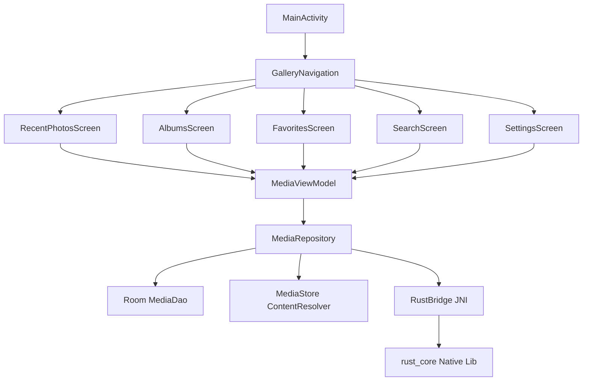

<div align="center">

# Lazzy Gallery

### Fast, smooth, privacy-first, and native-powered photo & video gallery for Android.

Lazzy Gallery is a high-performance, open-source media management application built with Jetpack Compose, Material 3, and a native Rust core for zero-lag performance and butter-smooth scrolling.


</div>

---

## Why this exists

Managing large photo and video collections (10,000+ items) on mobile devices often suffers from scroll stutter, memory spikes, and privacy intrusions from cloud sync apps. Rebuilding a fast, smooth gallery requires bypass of JVM garbage collection bottlenecks during heavy thumbnail decoding and indexing.

Lazzy Gallery solves these performance bottlenecks by offloading heavy image decoding, downscaling, EXIF extraction, and OCR image preprocessing to a native **Rust core** (`rust_core`). The app runs at 120 FPS with zero tracking, zero advertising SDKs, and complete local privacy.

The project is designed around a fast, predictable workflow:

```text
Open app -> Instant cache render -> Smooth scroll -> Native decode -> Local edit or share
```

There is no account system, sign-in flow, advertising SDK, cloud upload requirement, analytics service, or tracking endpoint.

## What it provides

| Capability | Description |
|------------|-------------|
| Native Rust Core | Offloads thumbnail decoding, downscaling, and EXIF extraction to compiled Rust NDK |
| Instant Cold Boot | Application-level cache pre-warming and Room B-tree database indexing |
| Butter-Smooth Grid | 16-bit `RGB_565` decoding with a 3-thread linear queue and 180ms crossfade transitions |
| OCR Text Search | Search photos by text contained within them using ML Kit & Rust contrast enhancement |
| Customizable Navigation | Customize the bottom-right navigation action to open Favorites, Camera, or File Manager |
| Expressive Theming | Dynamic Light & Dark themes with custom accent color blending across top headers |
| Local Privacy & Trash | Local bin recovery, hidden folder vault, and zero internet permission |

## Features

### Native Rust Engine

- Zero-overhead native thumbnail decoding via raw file descriptors (`ParcelFileDescriptor`)
- Fast 16-bit `RGB_565` image downscaling (50% less RAM usage, 2x faster JPEG decoding)
- Native EXIF metadata extraction (`rexif`) with JSON serialization
- High-contrast grayscale image preprocessing for ML Kit OCR text recognition

### Library & Recent Timeline

- Instant cold boot with pre-warmed memory cache
- Chronological timeline grouping by date added
- Customizable grid layout (2 to 5 columns for photos, 1 to 3 columns for albums)
- Range drag selection for batch sharing, trashing, or favoriting

### Albums & Folder Management

- Group photos and videos by storage folder/bucket
- Pin important albums to the top of the grid
- Hide sensitive folders from the main timeline view
- Create new album folders directly from the app

### Customizable Navigation Bar

- Floating, blurred bottom navigation bar
- Quick access to Library, Albums, Trash, and Search
- Customizable 3rd action button: toggle between **Favorites**, **Camera**, or **File Manager** in Settings

### Full-Screen Viewer & Video Player

- Smooth pinch-to-zoom and pan gestures
- Hardware-accelerated video playback powered by Media3 ExoPlayer
- Ambient backdrop blur effect behind full-screen media
- EXIF details inspector panel (resolution, aperture, ISO, exposure, focal length, camera model)

### Privacy & Recycle Bin

- Local Trash bin with soft-delete recovery and permanent deletion options
- Hidden media vault to shield sensitive photos from the timeline
- Operates 100% offline without the `INTERNET` permission

## Quick start

### Requirements

- Android Studio (Ladybug or newer recommended)
- Android SDK 35 (minSdk 24, targetSdk 35, compileSdk 37)
- JDK 17 or higher
- Rust toolchain (`rustup target add aarch64-linux-android armv7-linux-androideabi x86_64-linux-android`)
- `cargo-ndk` (`cargo install cargo-ndk`)
- Android NDK installed via Android Studio SDK Manager

### Clone the repository

```bash
git clone https://github.com/iabhnv19/LazzyGallery.git
cd LazzyGallery
```

### Open in Android Studio

1. Open Android Studio.
2. Select **Open** and choose the `LazzyGallery` repository directory.
3. Wait for Gradle sync to finish.
4. Connect a physical Android device or start an emulator.
5. Select the `app` run configuration.
6. Press **Run**.

The app launches instantly without any registration or account requirements.

## Build and test

### Windows

Build a debug APK (automatically compiles `rust_core` via `cargo-ndk`):

```bat
gradlew.bat assembleDebug
```

Run unit tests:

```bat
gradlew.bat testDebugUnitTest
```

### macOS and Linux

```bash
./gradlew assembleDebug
./gradlew testDebugUnitTest
```

The debug APK is generated at:

```text
app/build/outputs/apk/debug/app-debug.apk
```

### Build variants

| Variant | Purpose |
|---------|---------|
| `debug` | Local development with debug logging and native debug symbols |
| `release` | Minified release build using ProGuard and optimized Rust release binary |

Build a release APK with:

```bash
./gradlew assembleRelease
```

For Windows, use `gradlew.bat assembleRelease`.

## How to use

### Customize Bottom-Right Nav Button

1. Open **Settings** from the overflow menu in Albums or Library.
2. Tap **Bottom Right Nav Button**.
3. Cycle between **Favorites (Default)**, **Camera**, or **File Manager**.
4. The floating bottom navigation bar immediately updates its icon and action.

### Search Text in Photos (OCR)

1. Open **Settings** -> tap **Start OCR Scanning**.
2. Wait for the native Rust preprocessor and ML Kit to index text in your photos.
3. Navigate to **Search** screen and type any text (e.g., "receipt", "contract", "notes") to find matching photos instantly.

### Hide or Pin Albums

1. Open the **Albums** tab.
2. Long-press any album card.
3. Select **Pin folder to top** or **Hide folder**.

## Media Data Model

The app represents media items with this data structure:

```text
MediaModel
├── id
├── uri
├── displayName
├── dateAdded
├── dateModified
├── albumName
├── isVideo
├── duration
├── size
├── width & height
├── mimeType
├── isFavorite
├── isTrashed
└── ocrText?
```

Room Database (`media_index` table) maintains indexed columns on `dateAdded`, `isTrashed`, `isHidden`, and `albumName` for B-tree query speeds.

## Privacy and permissions

Lazzy Gallery is an offline-first application.

### Permissions Used

- `READ_MEDIA_IMAGES` & `READ_MEDIA_VIDEO` (Android 13+) / `READ_EXTERNAL_STORAGE` (Android 12 & lower)
- `READ_MEDIA_VISUAL_USER_SELECTED` (Android 14+)

### Security & Privacy Features

- Zero network calls (No `INTERNET` permission in `AndroidManifest.xml`).
- No advertising SDKs.
- No analytics or crash reporting servers.
- All media processing, OCR indexing, thumbnail generation, and EXIF extraction happen locally on-device.

## Architecture



### Component Responsibilities

| Component | Responsibility |
|-----------|----------------|
| `MainActivity` | Configures activity window, status bar icon theme, and Compose root |
| `GalleryNavigation` | Manages screen transitions and shared element animations |
| `MediaViewModel` | Exposes media Flow states, sorting, selection, and theme preferences |
| `MediaRepository` | Manages local Room database caching, MediaStore content observers, and Rust JNI |
| `RustBridge` | JNI wrapper executing native Rust thumbnail decoding, OCR contrast preprocessing, and EXIF parsing |
| `rust_core` | Native Rust crate (`cdylib`) compiling high-performance C-ABI functions for Android |
| `MediaStoreThumbnailFetcher` | Custom Coil fetcher executing 16-bit `RGB_565` native thumbnail decoding |
| `GalleryApplication` | Pre-warms media cache on launch and manages 3-thread linear Coil image loader |

## Project structure

```text
LazzyGallery/
├── app/
│   ├── build.gradle.kts
│   └── src/
│       ├── main/
│       │   ├── AndroidManifest.xml
│       │   ├── java/com/lazzy/gallery/
│       │   │   ├── data/                        # Repository, Coil fetcher, and Rust JNI bridge
│       │   │   │   ├── local/                   # Room database, entity, and DAO
│       │   │   │   └── worker/                  # Background sync workers
│       │   │   ├── ui/
│       │   │   │   ├── components/              # Floating nav bar, media grid items, video player
│       │   │   │   ├── navigation/              # App navigation routes
│       │   │   │   ├── screens/                 # Compose screens (Recent, Albums, Detail, Search, etc.)
│       │   │   │   └── theme/                   # Material 3 colors, typography, and palette generator
│       │   │   ├── GalleryApplication.kt        # Pre-warming & Coil configuration
│       │   │   └── MainActivity.kt              # Main Activity entry point
│       │   └── res/                             # Icons, themes, strings, and XML resources
├── rust_core/                                   # Native Rust crate
│   ├── Cargo.toml
│   └── src/
│       └── lib.rs                               # JNI functions (image decoding, OCR prep, EXIF)
├── .github/
│   ├── ISSUE_TEMPLATE/                          # Bug report & feature request templates
│   └── PULL_REQUEST_TEMPLATE.md                 # PR template
├── CODE_OF_CONDUCT.md
├── CONTRIBUTING.md
├── LICENSE
├── README.md
└── SECURITY.md
```

## Dependencies

| Library | Purpose |
|---------|---------|
| Jetpack Compose | Declarative UI toolkit |
| Material 3 | Modern Material Design components |
| Coil | Reactive image loading pipeline |
| Media3 ExoPlayer | Hardware-accelerated video playback |
| Room | Local SQLite database ORM |
| ML Kit Text Recognition | On-device OCR text extraction |
| Rust `image` & `rexif` & `imageproc` | Native image downscaling, EXIF extraction, & image processing |

## Troubleshooting

<details>
<summary><b>Cargo-NDK build fails or command not found</b></summary>

Install `cargo-ndk` via Cargo: `cargo install cargo-ndk`. Ensure Android NDK is installed via Android Studio SDK Manager and `ANDROID_NDK_HOME` or `ndk.dir` is set.
</details>

<details>
<summary><b>Thumbnails take a moment to load on first launch</b></summary>

Thumbnails are decoded natively on-demand and saved to the local disk cache (`cacheDir/thumbnails`). Once cached, subsequent scrolls retrieve 16-bit `RGB_565` bitmaps instantly from RAM.
</details>

<details>
<summary><b>Status bar icons are hard to see in Light Mode</b></summary>

The app automatically controls system bar contrast (`isAppearanceLightStatusBars`). If custom ROMs override system bar styling, toggle Dark Theme in Settings.
</details>

## Known limitations

- Cloud backup integration (e.g. Google Drive / Nextcloud) is intentionally excluded to preserve 100% local privacy.
- RAW camera image files (.CR2, .NEF) are downscaled using Android system decoders if the native Rust decoder misses.

## Contributing

Contributions are welcome! Please read [CONTRIBUTING.md](CONTRIBUTING.md) and [CODE_OF_CONDUCT.md](CODE_OF_CONDUCT.md) before opening issues or pull requests.

## License

Lazzy Gallery is released under the [GNU Affero General Public License v3.0 (AGPLv3)](LICENSE).

## Developer

Developed By
<div align="center">

<table>
  <tr>
    <td align="center">
      <a href="https://github.com/iabhnv19">
        
        <br />
        <strong>Abhinav</strong>
        <br />
        @iabhnv19
      </a>
    </td>
  </tr>
</table>
</div>

<div align="center">

**Built with Kotlin, Rust, and Jetpack Compose for a blazing-fast, privacy-first gallery experience.**

</div>
"